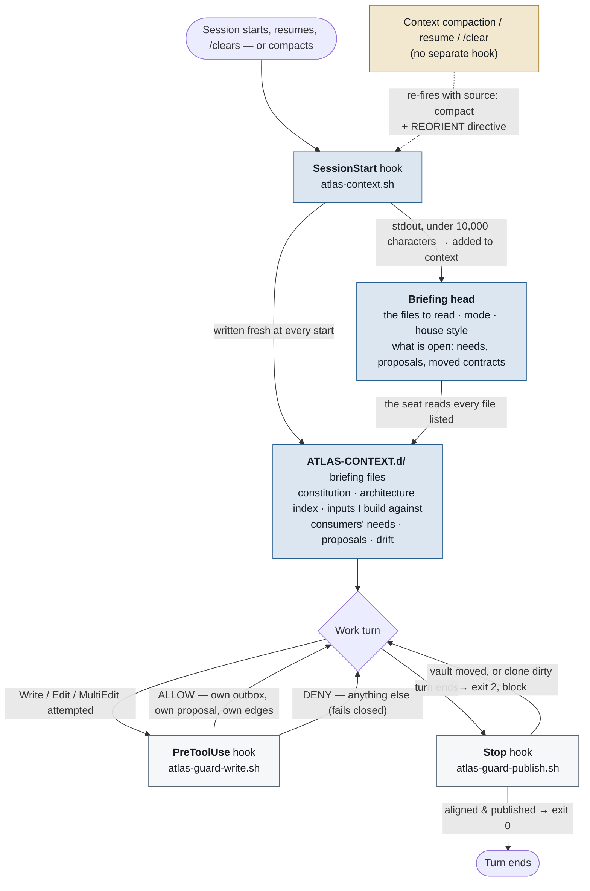

# The context plane — how Atlas fills and guards an agent's window

Atlas holds what is true; three hooks put the right slice of it in front of the agent at
the moment it's needed — and keep the rest out. **The reads are compiled for the seat,
never left for it to find.** The head of the briefing goes into the window; the rest goes
into files the head lists, and the seat reads them first (1.35.9). This is the full
lifecycle for a component seat.

> A richly-designed version of this diagram ships beside this file as
> [`context-plane.html`](context-plane.html) — open it in a browser (GitHub shows HTML
> as source, not rendered).

## The three hooks

Every seat's hook file wires exactly these, one file per agent runtime (see
[Runtimes](#runtimes)). A hook is a shell script the runtime runs at a lifecycle moment;
what it prints and the code it exits with are how Atlas reaches into the session.

| Hook | Script | Fires | Does |
|---|---|---|---|
| **SessionStart** | `atlas-context.sh` | startup · resume · `/clear` · **compaction** (no matcher) | Compiles the whole reading list. Prints its head to stdout — the runtime adds it to the context window — and writes the rest to files in `ATLAS-CONTEXT.d/` that the head lists first. The main injection, and the only one. |
| **PreToolUse** | `atlas-guard-write.sh` | before every file write (Claude Code: `Write` / `Edit` / `MultiEdit` / `NotebookEdit`; Codex: `apply_patch`) | Decides per file whether the write may land. Allows the seat's own outbox, an additive proposal, and edges naming it; refuses everything else (exit 2, the reason on stderr); fails closed. |
| **Stop** | `atlas-guard-publish.sh` | end of every turn | Two checks that can exit 2 to refuse the turn's end: the **alignment gate** (vault moved since the briefing? re-brief) and the **publish nag** (vault clone dirty? `/atlas-publish`). Fails open offline. |

*(An arch seat has no slug and works the vault directly: `SessionStart` runs
`atlas-arch-context.sh` (`--emit-arch-context`), `Stop` runs the arch alignment gate, and
`PreToolUse` runs `atlas-arch-write.sh`, which refuses `product/**`. A product seat and a
test seat have the same three, with their own scripts.)*

## Reorientation is a source, not a separate hook

There is **no separate compaction or reorientation hook** — and that is why `SessionStart`
carries no matcher. When the window is summarised, resumed, or cleared, the same hook
re-fires with its `source`, rebuilds the briefing from scratch, and prepends a directive:

| `source` | What it means | Reorientation? |
|---|---|---|
| `startup` | a fresh session | briefing head injected plainly; agent also reads `AGENTS.md` |
| `compact` | context was summarised to fit | **yes** — REORIENT prepended |
| `resume` | a session picked back up | **yes** — REORIENT prepended |
| `clear` | the window was deliberately wiped | **yes** — REORIENT prepended |

The directive is the text of [`templates/reorient.md`](templates/reorient.md), the same
for every kind of seat. It opens:

> ⟳ REORIENT — your context was just compacted. What you remember is a lossy summary: it
> can state intentions as done, drop constraints, and merge separate items. Your briefing
> is fresh; your memory is not. Re-orient from durable state before doing anything:
>
> 0. Your briefing: if it lists files at its top, read every one now, in full. This text
>    is only its head.

Six more steps follow: repos, the seat, contracts, the bridge, reconcile, order of work.
(Until 1.35.9 a component seat got a four-line banner instead; its script tested the
wrong variable.)

Atlas rebuilds the whole briefing rather than trying to preserve fragments through the
summary — the durable orientation is the compiled file, not whatever survived compaction.

## The head and the files (1.35.9)

A runtime carries a limited amount of text from one hook. Claude Code carries 10,000
characters. Over that it keeps the first 2,000 and a path to a saved copy, and it does
not ask the agent to read the copy. A briefing is 34,000 to 81,000 characters. Until
1.35.9 a seat therefore saw the first 2,000 characters of its briefing and no more.

So the hook prints a **head**, held under 9,000 characters, and writes the rest to files.

| Where | What |
|---|---|
| the head, in the context window | the list of files, inside the first 2,000 characters; warnings; the mode and the house style; the reorientation steps after a compaction; who the seat is; one line for each unanswered need, each proposal in flight and each contract that has moved |
| `ATLAS-CONTEXT.d/1-constitution.md` | the constitution, in full |
| `ATLAS-CONTEXT.d/2-architecture.md` | architecture in force, the reference library, addresses, the hub |
| `ATLAS-CONTEXT.d/3-contracts.md` | the contracts the seat builds against, in full |
| `ATLAS-CONTEXT.d/4-needs.md` | the needs addressed to the seat, in full |
| `ATLAS-CONTEXT.d/5-proposals-and-drift.md` | proposals in flight, in full, and the drift table |

An arch seat's files are `1-constitution.md`, `2-architecture.md`, `3-estate-and-drift.md`,
`4-needs-and-proposals.md` and `5-next-steps.md`, in `ATLAS-CONTEXT.d/` in its launch dir.
A seat that holds both roles gets the component files and three more for the arch role,
numbered 6 to 8. `~/.atlas/needs-open.md` is listed with them when it has content.

- **The seat reads every listed file before it acts.** The hook cannot do that for it.
- The folder is removed and written fresh at every start. It is local, never committed.
- A head that would be over 9,000 characters is cut at a line end. The head says so, and
  the whole head is saved as `0-head-in-full.md`, listed first.
- A seat whose scripts are newer than its pinned method gets the whole briefing in one
  file, `0-briefing.md`, and a head that names it.
- `atlas_init --verify` fails a hook that prints more than 10,000 characters.
- `atlas_validate.py --emit-context` without `--parts-dir` still prints the whole
  briefing as one text.

Tested 2026-11-17 on Claude Code 2.1.295, in one session on a fixture seat: the head
arrived whole, and the session read the files unasked and answered from them. Not tested:
Codex, and later Claude Code versions.

## What the briefing carries — and what it doesn't

Carried, in this order across the files: the **constitution** (full); the **architecture-in-force** index
and **reference-library** index (read on demand — listing them makes reading retrieval,
not browsing); cross-vault **inputs** routed to this consumer; the seat's **shared needs**
once; per component, the **inputs it builds against** and its consumers' **open needs**;
**in-flight proposals**; and the **drift summary**.

Kept out on purpose: the **wider vault** (the retrieval invariant — read the briefing, fix
the graph if it's insufficient); **raw contract artifacts** (delivered as files to
`ATLAS-CONTEXT.d/`, referenced by path, never inlined); **other components' deliveries**
(one index line, not the body); and **answered or retired needs** (collapsed or dropped —
a briefing carries current obligations, not history).

## Runtimes

The scripts are the same on every agent runtime. What differs is the file that tells the
runtime when to run them. One table holds both halves:
[`templates/seat-hooks.json`](templates/seat-hooks.json).

- `roles`: what each kind of seat runs at each moment (briefing, write guard, shell guard,
  turn-end gate, style line), and its write scope.
- `runtimes`: how one runtime is told (its hook file, its event names, the tools that
  write files, how a hook command finds the repo).

`atlas_init.py` writes the hook file for **every** runtime in the table. A runtime reads
only its own file, so a seat can change runtime without a re-install.

| Runtime | Hook file | Writes files with | Publish in supervised mode |
|---|---|---|---|
| Claude Code | `.claude/settings.json` | `Write`, `Edit`, `MultiEdit`, `NotebookEdit` | asks the operator |
| Codex | `.codex/hooks.json` | `apply_patch` | cannot ask: refused once, the same command goes through when run again within the hour |

Tested on Claude Code and on Codex CLI 0.160.0.

**A runtime with no hooks, or whose hooks did not run.** The installer writes a short
block into `AGENTS.md` at the launch dir. It tells the agent what to do when no briefing
is in its context: run the briefing script, keep the write scope by hand, run the
turn-end gate before finishing, and tell the operator. Vault CI still checks every pull
request.

**Codex trust.** Codex needs two kinds of trust and gives no warning when either is
missing. It reads `.codex/hooks.json` only in a folder it trusts. It skips a new or
changed hook until the hook is trusted. A seat started by the seat tool is never asked
for either. After an install, and after any upgrade that changes `.codex/hooks.json`,
from a shell on the seat and outside any session:

1. Seat provisioning has trusted the launch dir: `~/.codex/config.toml` has a
   `[projects."<launch dir>"]` section with `trust_level = "trusted"`. The method does
   not write it.
2. Run `python3 <method>/tools/codex_trust.py --launch-dir <launch dir> --record`. It
   must end `codex_trust: ready`.
3. Stop every session running on the seat and start it again. That includes the session
   that receives hub messages.
4. Check that the seat answers and that its briefing is in its context.

`<method>` is the method checkout the seat's scripts were copied from. Run from a newer
checkout, add `--method <the seat's checkout>`. The tool asks
Codex for the hooks it sees and has Codex record the trust, as Codex's `/hooks` screen
does. It trusts a hook only when the hook is in the launch dir's hook file and runs a
script that is the same as the method's. It leaves any other hook untrusted and says
so. Without `--record` it only reports. Exit 0 is ready, 1 is not ready, 2 is Codex
could not be asked.

By hand, where the tool cannot run: start Codex in the launch dir, answer yes to trust
the folder, open `/hooks`, trust the Atlas hooks, quit, then step 3. If `/hooks` lists
none, the folder is not trusted (seen on five seats, 2026-11-18).

A session started before step 2 runs without the hooks: it has no briefing and its writes
are not checked (seen on a real seat, 2026-11-18). Until it is restarted it writes
nothing. A session never restarts itself: one that tried ended and no new one started.
A restart may archive the old conversation; it is not deleted.

Tested 2026-11-18 on Codex CLI 0.160.0 with a scratch Codex home. Not tested: a real
seat that the seat tool starts.

**Check an install.** `atlas_init.py --verify` (with `--arch`, `--product` or `--test` for
those seats) fires each runtime's write guard as wired, at one path it must allow and one
it must refuse. It warns when Codex does not trust the launch dir (1.36.3). It cannot see
whether the hooks are trusted; `codex_trust.py` without `--record` does.

**To add a runtime:**

1. Add one entry under `runtimes` in `templates/seat-hooks.json`.
2. If its write payload has a new shape, add one branch to
   `templates/component-repo/scripts/atlas-payload.py`.
3. Run `python3 tools/tests/test_seat_hooks.py`.
4. If the runtime must be told to trust the hooks, add a tool that does it without a
   person and name it as `trust_tool` in the entry.
5. Install on a real seat of that runtime, started the way the estate starts it, and
   run `--verify`.
6. In a live session there, check: the briefing is in context, a write outside the scope
   is refused, a write inside the scope lands.
7. Do not release until steps 5 and 6 have passed with no person at the seat.
